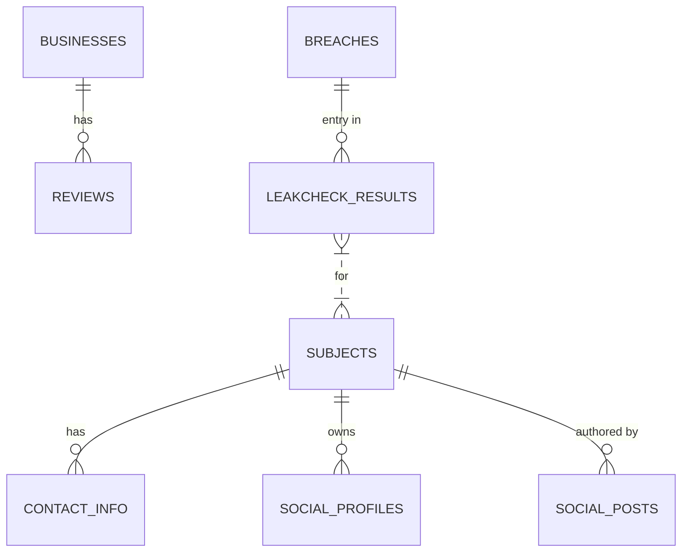
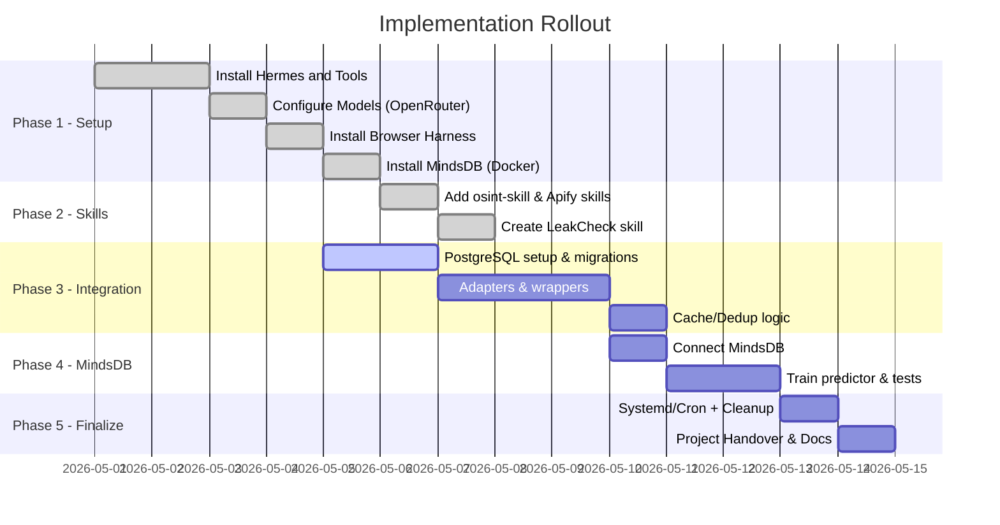

# Hermes Agent, MindsDB та навички: від встановлення до робочого конвеєра даних

> [!note] Окремий практичний модуль
> Цей матеріал у джерелі був позначений як «Урок 4», але офіційний Урок 4 курсу — [[../../01-Уроки/Урок-04-Соцмережі-та-медіапростір|Соціальні мережі та медіапростір]]. Тут — самостійний поглиблений модуль про побудову агентного конвеєра (Hermes Agent + MindsDB), який можна проходити паралельно чи додатково.

## Розділи модуля

- [[01-Full-OSINT-agent-guide|Full OSINT agent guide]]
- [[02-Домашнє-завдання|Домашнє завдання]]

Вітаю вас на четвертому уроці нашого курсу! На попередніх уроках ми познайомилися з концепцією AI-агентів, навчилися працювати з LLM через API та розібралися з базовою структурою навичок (skills). Тепер настав час зібрати все це в один робочий проєкт.

## Про що цей урок

У цьому уроці ми разом побудуємо повноцінний агентний конвеєр на вашій машині з Ubuntu 24.04. Це не просто встановлення окремих інструментів — ми вибудуємо систему, у якій:

- **Hermes Agent** виступає «мозком», який керує виконанням завдань через LLM.
- **Browser Harness** дає агенту руки для керування браузером.
- **Навички OSINT та Apify** перетворюють агента на справжнього дослідника, здатного збирати дані з десятків джерел.
- **PostgreSQL** стає довготривалою пам'яттю: усе, що агент знайшов, зберігається у структурованих таблицях.
- **MindsDB** додає прошарок машинного навчання — ми навчимо модель прогнозувати витоки email-адрес просто через SQL-запит.

Головна ідея уроку така: **агент без пам'яті — це калькулятор, який забуває відповідь одразу після її виведення**. Ми навчимо нашого агента пам'ятати, кешувати, дедуплікувати та робити висновки з накопичених даних.

## Чого ви навчитеся

Після завершення уроку ви будете вміти:

1. Встановлювати Hermes Agent та підключати його до сторонньої LLM через OpenRouter.
2. Реєструвати нові навички в каталозі `~/.hermes/skills` (на прикладі OSINT, Apify та власноруч написаного LeakCheck).
3. Проєктувати нормалізовану схему PostgreSQL під результати OSINT-розслідувань.
4. Писати **адаптери** — скрипти-містки між JSON-виходом навички та таблицями БД.
5. Додавати до обгорток навичок логіку **кешування** та **TTL** (time-to-live), щоб не витрачати зайвих токенів та API-квот.
6. Розгортати MindsDB у Docker, підключати до нього Postgres та створювати ML-предиктор одним SQL-запитом.
7. Автоматизувати синхронізацію та резервне копіювання через `cron` та `systemd`-таймери.
8. Писати модульні та наскрізні (end-to-end) тести для всього конвеєра.

## Що вам знадобиться перед початком

- Свіжо встановлена Ubuntu 24.04 (підійде віртуальна машина або WSL 2).
- Права `sudo` на вашому користувачеві.
- API-ключ OpenRouter (реєстрація безкоштовна).
- За бажанням — ключі для Apify, Jina, Perplexity, Exa, Tavily, LeakCheck та інших сервісів. Урок працює і без них, просто відповідні навички будуть обмежені.
- Приблизно 2–3 години часу. Не поспішайте — краще робити крок за кроком і перевіряти результат після кожного розділу.

## Як читати цей урок

Урок побудовано як серію практичних кроків. Кожен розділ — це один логічно завершений етап. **Я наполегливо рекомендую виконувати команди у тому ж порядку, у якому вони подані**: наступний крок часто залежить від результатів попереднього. Усі фрагменти коду, команди та шляхи до файлів наведені точно, без перефразування — копіюйте їх як є.

У кінці уроку ви знайдете:
- ER-діаграму бази даних;
- Gantt-графік повного розгортання проєкту;
- глосарій ключових термінів;
- «суворий» однорядковий промпт, який можна віддати самому Hermes, щоб він виконав усе це автоматично (корисно для другого проходу, коли ви вже розумієте, що відбувається).

А тепер — до справи.

---

## Суворий промпт для агента Hermes

Перед тим як занурюватися у ручне встановлення, давайте подивимося на «чарівну паличку» — однокрокову інструкцію, яку ви зможете передати Hermes після проходження уроку, щоб він автоматично виконав усі кроки. Не запускайте її зараз — просто ознайомтеся, щоб побачити масштаб того, що ми робитимемо вручну:

```text
Implement a complete Postgres+MindsDB persistence solution for my Hermes skills. Audit the skills in ~/.hermes/skills (osint, leakcheck, apify-ultimate-scraper, and other Apify skills). Create a new PostgreSQL database `hermes_db` and run migration SQL (`hermes_db_migration.sql`) to set up normalized tables (subjects, contacts, social_profiles, social_posts, businesses, reviews, breaches, leakcheck_results, query_log, raw_results). Install psycopg2-binary and node-postgres in the Hermes virtual environment (`uv pip install psycopg2-binary` and `npm install -g pg node-fetch`). For each skill, add an adapter script under ~/.hermes/skills/<skill>/scripts that parses the skill's JSON output (JSON/JSONL) and does parameterized `INSERT ... ON CONFLICT` into Postgres (handling nested arrays and saving attachments by URL or bytea). Modify each skill's wrapper to first query the DB for cached data (exact match and TTL checks) and skip the external API call if found; otherwise run the API and then upsert the results. Configure deduplication by using UNIQUE constraints and `ON CONFLICT` updates. Set up MindsDB Docker (container "mindsdb") to connect to hermes_db: use `CREATE DATABASE hermes_pg ENGINE='postgres'` with `"host": "host.docker.internal"`, port 5432, and your DB creds. Create a MindsDB predictor `breach_predictor` on leakcheck_results (predicting `found`). Schedule a systemd service or cron job to run periodic data syncs and nightly `pg_dump` backups. Update ~/.hermes/.env with DB_HOST, DB_PORT, DB_NAME, DB_USER, DB_PASS, and all API keys (APIFY_API_TOKEN, JINA_API_KEY, etc.). Finally, write unit tests for each adapter (using sample JSON) and an end-to-end test that runs a LeakCheck query and an Apify actor, then checks Postgres rows and the MindsDB predictor output. After each step, report the changed files and run tests. Do not just explain – perform each change in-place. 
```

Запам'ятайте цей промпт — ми повернемося до нього наприкінці уроку.

---

## Крок 1. Встановлення Hermes Agent та налаштування LLM

Почнемо з «мозку» системи. Hermes — це агент, який читає наші навички у форматі Markdown і виконує їх, викликаючи LLM за потреби. На цьому кроці ми встановимо сам агент і підключимо до нього модель через OpenRouter (це дасть нам доступ до Qwen 3.6 та GPT-5.x без окремої реєстрації в OpenAI).

1. **Встановіть Hermes Agent.** Запустіть офіційний інсталяційний скрипт【36†L40-L47】:
   ```bash
   curl -fsSL https://raw.githubusercontent.com/NousResearch/hermes-agent/main/scripts/install.sh | bash
   source ~/.bashrc
   ```
   Цей скрипт встановлює команду `hermes` та підготовлює оточення Python 3.11 / Node.js 20. Якщо команда `hermes` не знайдена після `source ~/.bashrc`, відкрийте новий термінал.

2. **Отримайте ключ OpenRouter.** Зареєструйтеся на [openrouter.ai](https://openrouter.ai) і згенеруйте API-ключ для Qwen 3.6 або новішої моделі. Збережіть ключ у надійному місці — показати його вдруге платформа не дозволяє.

3. **Налаштуйте Hermes для роботи з OpenRouter.** Відкрийте (або створіть) файл `~/.hermes/.env` і додайте два рядки:
   ```bash
   OPENROUTER_API_KEY=<your_key_here>
   OPENAI_BASE_URL=https://openrouter.ai/api/v1
   ```
   Потім запустіть майстер налаштування моделі:
   ```bash
   hermes setup model
   ```
   Відповідайте на його запитання так:
   - Для пункту **Custom endpoint** — оберіть його.  
   - Для **Base URL** введіть `https://openrouter.ai/api/v1`.  
   - Для **API key** вставте значення `OPENROUTER_API_KEY`.  
   - Для **Model** введіть, наприклад, `openai/gpt-5.4` (або `openai/gpt-5`, якщо 5.4 недоступна).  

   Таким чином ви кажете Hermes: «використовуй OpenAI-сумісний інтерфейс OpenRouter (тобто моделі з префіксом `openai/gpt-*`), щоб насправді звертатися до Qwen 3.6 / GPT-5.x».

4. **Перевірте, що все працює.** Запустіть:
   ```bash
   hermes doctor
   ```
   Ця команда проаналізує встановлення і повідомить про проблеми. Потім спробуйте короткий діалог:
   ```bash
   hermes chat -q "Hello"
   ```
   Якщо налаштування правильне, ви побачите відповідь від моделі. Якщо ні — поверніться до пункту 3 і перевірте ключ та Base URL.

## Крок 2. Встановлення Browser Harness та Browser Use

Тепер додамо агенту «руки» для керування браузером. Browser Harness дозволяє Hermes відкривати сторінки, клікати та заповнювати форми в Chrome або Firefox. Browser Use — це хмарний сервіс, який надає той самий функціонал, але у стелс-режимі з ротацією проксі (корисно, коли цільовий сайт блокує автоматизацію).

1. **Встановіть Browser Harness локально:**
   ```bash
   cd ~
   git clone https://github.com/browser-use/browser-harness.git
   cd browser-harness
   uv tool install -e .
   ```
   Ми використовуємо пакетний менеджер `uv`, який Hermes встановив разом зі своїм оточенням.

2. **Зареєструйте Browser Harness як навичку Hermes:**
   ```bash
   mkdir -p ~/.hermes/skills/browser-harness
   ln -s ~/browser-harness/SKILL.md ~/.hermes/skills/browser-harness/SKILL.md
   ln -s ~/browser-harness/*.js ~/.hermes/skills/browser-harness/
   ```
   Ми створюємо символічні посилання, щоб Hermes «побачив» навичку. Якщо у майбутньому ви оновите Browser Harness (`git pull`), навичка оновиться автоматично — це зручно.

3. **Налаштуйте Browser Use Cloud (за бажанням).** Якщо планується скрейпінг захищених сайтів, отримайте безкоштовний API-ключ на [Browser Use Cloud](https://cloud.browser-use.com)【60†L89-L98】 і запустіть:
   ```bash
   hermes setup tools
   ```
   - Оберіть **Browser Automation** → **Browser Use**.  
   - Вставте API-ключ【60†L89-L98】.  

   Альтернативний шлях — вручну додати `BROWSER_USE_API_KEY=<key>` до `~/.hermes/.env`. Після цього вбудовані інструменти на кшталт `browser_navigate` за замовчуванням працюватимуть через хмару【60†L89-L98】.

4. **(Альтернативно) Встановлення через CLI Browser Use.** Якщо ви віддаєте перевагу окремому CLI-клієнту:
   ```bash
   curl -fsSL https://browser-use.com/cli/install.sh | bash
   browser-use doctor
   hermes skills install skills-sh/browser-use/browser-use/browser-use
   browser-use cloud login <your_key>
   ```
   Так ви отримаєте CLI-навичку Browser Use для Hermes【60†L125-L134】. Агент зможе викликати `browser-use` через свій термінальний інструмент.

## Крок 3. Встановлення навичок Hermes (OSINT, Apify, LeakCheck)

На цьому етапі ми додамо три родини навичок. OSINT — для збору публічної інформації про осіб та компанії. Apify — для промислового скрейпінгу соцмереж та веб-сайтів. LeakCheck ми напишемо самостійно — це хороший міні-проєкт, щоб зрозуміти анатомію навички.

### Навичка OSINT

1. **Клонуйте та скопіюйте в каталог навичок:**  
   ```bash
   git clone https://github.com/smixs/osint-skill.git ~/.local/src/osint-skill
   cp -r ~/.local/src/osint-skill/osint ~/.hermes/skills/osint
   ```
   Навичка OSINT — це багатофазовий «слідчий», який послідовно збирає дані з різних джерел (соцмережі, пошук, витоки).

2. **Запустіть діагностику:**
   У каталозі `~/.hermes/skills/osint` виконайте:
   ```bash
   bash ./scripts/diagnose.sh
   ```
   Скрипт перевірить, які інструменти та ключі доступні, і напише список того, що відсутнє【61†L292-L297】. Не лякайтеся, якщо все одразу червоне — зараз додамо ключі.

3. **Ключі до зовнішніх API.** Ось повний перелік сервісів, які вміє використовувати OSINT-навичка. Для кожного сервісу вказано змінну оточення, куди потрібно записати ключ у `~/.hermes/.env`:
   - **Apify Actors** (`APIFY_API_TOKEN`) — скрейпінг соцмереж (Instagram, TikTok, YouTube, LinkedIn) для отримання публічних даних【61†L329-L333】.  
   - **Jina AI** (`JINA_API_KEY`) — семантична пошукова система для глибоких запитів за знаннями【61†L328-L331】.  
   - **Parallel AI** (`PARALLEL_API_KEY`) — AI-пошук з логічним міркуванням та цитуваннями【61†L329-L333】.  
   - **Perplexity** (`PERPLEXITY_API_KEY`) — швидкі відповіді («Sonar») та режим глибокого дослідження【61†L338-L341】.  
   - **Exa AI** (`EXA_API_KEY`) — семантичний пошук людей/компаній【61†L338-L341】.  
   - **Tavily** (`TAVILY_API_KEY`) — агентний розмовний пошук【61†L338-L341】.  
   - **Bright Data MCP** (`BRIGHTDATA_MCP_URL`) — резидентні проксі для обходу CAPTCHA та авторизації【61†L347-L349】.  
   - **LeakCheck** (`LEAKCHECK_API_KEY`) — перевірка, чи email траплявся у витоках даних.  
   - **Himalaya** — CLI-клієнт пошти, без ключа. Встановлюється як `sudo apt install himalaya` і за бажанням використовується для пошуку в локальній скриньці.  
   - **tg.py** — неофіційний Python-скрипт для скрейпінгу Telegram-каналів, без ключа. Має лежати в `PATH`.

   Приклад мінімального блоку для `~/.hermes/.env`:
   ```
   APIFY_API_TOKEN=apify_api_...
   JINA_API_KEY=jina_...
   PARALLEL_API_KEY=parallel_...
   PERPLEXITY_API_KEY=pplx_...
   EXA_API_KEY=exa_...
   TAVILY_API_KEY=tvly_...
   BRIGHTDATA_MCP_URL="https://mcp.brightdata.com/..."
   LEAKCHECK_API_KEY=lk_...
   # Himalaya and tg.py don't use env vars
   ```
   Чим більше ключів ви додасте, тим глибшим буде OSINT-розслідування【61†L328-L333】【61†L338-L341】. Не обов'язково мати всі — на початку достатньо кількох.

### Навички агентів Apify

1. **Клонуйте репозиторій і скопіюйте потрібні навички:**
   ```bash
   git clone https://github.com/apify/agent-skills.git ~/.local/src/apify-agent-skills
   cp -r ~/.local/src/apify-agent-skills/skills/apify-ultimate-scraper ~/.hermes/skills/
   cp -r ~/.local/src/apify-agent-skills/skills/apify-actor-development ~/.hermes/skills/
   cp -r ~/.local/src/apify-agent-skills/skills/apify-actorization ~/.hermes/skills/
   cp -r ~/.local/src/apify-agent-skills/skills/apify-generate-output-schema ~/.hermes/skills/
   ```
   Або — якщо у вас встановлений Skills Hub CLI — один рядок замість чотирьох:
   ```
   npx skills add apify/agent-skills
   ```
  【49†L289-L297】. Це додає у Hermes готові навички скрейпінгу (зокрема, **apify-ultimate-scraper**, яким ми скористаємося на кроці тестування).

2. **Apify CLI (за бажанням).** Якщо плануєте розробляти власні актори Apify або контролювати їх з командного рядка, встановіть CLI та MCPC:
   ```
   npm install -g apify-cli @apify/mcpc
   ```
   Переконайтеся, що у вас у `.env` виставлений `APIFY_TOKEN` або `APIFY_API_TOKEN`.

### Навичка LeakCheck (пишемо самостійно)

Це найцікавіша частина кроку 3. Ми з нуля створимо просту навичку, щоб ви побачили, з чого вона взагалі складається — метадані в SKILL.md плюс скрипт.

1. **Створіть каталог навички:**
   ```bash
   mkdir -p ~/.hermes/skills/leakcheck
   ```

2. **Додайте файл SKILL.md.** У `~/.hermes/skills/leakcheck/SKILL.md` запишіть:
   ```markdown
   name: LeakCheck
   description: Check if an email address was exposed in any data breaches (via the LeakCheck API).
   author: Your Name
   ---
   # LeakCheck Skill
   Run `leakcheck <email>` to query the LeakCheck API. Requires `LEAKCHECK_API_KEY` in ~/.hermes/.env.
   ```
   Зверніть увагу на структуру: спочатку метадані (name, description, author), потім роздільник `---`, потім пояснення природною мовою. Саме це пояснення читає LLM, коли агент вирішує, чи підходить навичка для завдання.

3. **Створіть виконуваний скрипт запиту** — `query.sh` у тій самій папці:
   ```bash
   #!/bin/bash
   if [ -z "$1" ]; then echo "Usage: hermes run leakcheck example@example.com"; exit 1; fi
   EMAIL="$1"
   if [ -z "$LEAKCHECK_API_KEY" ]; then echo "LEAKCHECK_API_KEY not set"; exit 1; fi
   # Call LeakCheck API (example endpoint)
   curl -s "https://leakcheck.io/api/v2/query/$EMAIL" \
        -H "Accept: application/json" \
        -H "X-API-Key: $LEAKCHECK_API_KEY"
   ```
   Зробіть його виконуваним:
   ```bash
   chmod +x ~/.hermes/skills/leakcheck/query.sh
   ```

4. **Перевірте роботу:**
   ```bash
   hermes run leakcheck test@example.com
   ```
   Якщо ключ встановлений, ви побачите JSON від LeakCheck. Вітаю — ви щойно створили свою першу кастомну навичку!

## Крок 4. Встановлення MindsDB у Docker та підключення до Postgres

MindsDB — це «AI-прошарок» над базою даних. Він дозволяє писати SQL на кшталт `SELECT predicted_value FROM my_model WHERE ...` і отримувати ML-прогноз без написання жодного рядка Python. Ми використаємо MindsDB, щоб навчити модель прогнозувати, чи потрапляв email у витоки.

1. **Встановіть Docker, якщо його ще немає:**
   ```bash
   sudo apt update
   sudo apt install -y docker.io
   sudo systemctl enable --now docker
   ```

2. **Запустіть контейнер MindsDB:**
   ```bash
   docker pull mindsdb/mindsdb
   docker run -d --name mindsdb -p 47334:47334 mindsdb/mindsdb
   ```
   Після цього вебінтерфейс MindsDB доступний на `http://localhost:47334`【51†L165-L173】.

3. **Підготуйте Postgres до з'єднань з контейнера.** Оскільки MindsDB живе в Docker, він не бачить Postgres як «localhost» хост-машини. Два варіанти: або налаштувати Postgres на прослуховування всіх інтерфейсів (`listen_addresses = '*'` у `postgresql.conf` плюс правило в `pg_hba.conf`), або використовувати спеціальний DNS-хост `host.docker.internal` (доступний у більшості сучасних версій Docker). Після змін у конфігах — перезапустіть Postgres.

4. **Створіть інтеграцію MindsDB → Postgres.** У SQL-консолі MindsDB (`http://localhost:47334`) виконайте:
   ```sql
   CREATE DATABASE hermes_pg
   WITH ENGINE = 'postgres',
   PARAMETERS = {
     "host": "host.docker.internal",
     "port": "5432",
     "database": "hermes_db",
     "user": "hermes_user",
     "schema": "public",
     "password": "YOUR_DB_PASS"
   };
   ```
   Тут `host.docker.internal` потрібен саме через те, що MindsDB живе у контейнері【51†L165-L173】.

5. **Перевірте, що таблиці видно:**
   ```sql
   SELECT * FROM hermes_pg.subjects LIMIT 5;
   SELECT * FROM hermes_pg.leakcheck_results LIMIT 5;
   ```
   На цьому етапі таблиці ще порожні — це нормально. Якщо запит видає помилку з'єднання, повертайтеся до пункту 3 і перевіряйте параметри.

6. **Навчіть модель `breach_predictor`:**
   ```sql
   CREATE PREDICTOR breach_predictor
   FROM hermes_pg (
       SELECT email, found FROM leakcheck_results
   ) AS leak_data
   PREDICT found;
   ```
   MindsDB автоматично побудує модель, яка за полем `email` прогнозуватиме `found`. Синтаксис збігається з прикладом Mushrooms з офіційної документації MindsDB【51†L165-L173】.

7. **Спробуйте зробити прогноз:**
   ```sql
   SELECT found_explain
   FROM mindsdb.breach_predictor
   WHERE email = 'alice@example.com';
   ```
   Ви отримаєте передбачення (найімовірніше `false`, доки у вас немає реальних даних). Коли наповните `leakcheck_results`, прогнози стануть змістовнішими.

## Крок 5. Створення схеми Postgres та міграцій

Час побудувати довготривалу пам'ять системи — реляційну базу даних. Ми навмисно робимо її **нормалізованою**: окремі таблиці для суб'єктів, контактів, профілів, постів, бізнесів тощо. Це дає змогу ефективно запитувати та уникати дублювання.

1. **Встановіть PostgreSQL:**
   ```bash
   sudo apt install -y postgresql postgresql-contrib
   sudo systemctl enable --now postgresql
   ```

2. **Створіть базу та користувача:**
   ```bash
   sudo -u postgres psql -c "CREATE USER hermes_user WITH PASSWORD 'change_me';"
   sudo -u postgres psql -c "CREATE DATABASE hermes_db OWNER hermes_user;"
   ```
   Обов'язково поміняйте `change_me` на щось справжнє — і не забудьте оновити цей пароль у `.env`.

3. **Напишіть SQL-міграцію.** Створіть файл `hermes_db_migration.sql` з нашою схемою. Уважно читайте коментарі у таблицях — вони пояснюють призначення кожної:

   ```sql
   -- hermes_db_migration.sql
   CREATE TABLE subjects (
       id SERIAL PRIMARY KEY,
       name TEXT UNIQUE,
       dob DATE,
       location TEXT,
       last_seen TIMESTAMP DEFAULT NOW()
   );
   CREATE TABLE contact_info (
       id SERIAL PRIMARY KEY,
       subject_id INT REFERENCES subjects(id),
       type TEXT, value TEXT,
       first_seen TIMESTAMP DEFAULT NOW(),
       last_seen TIMESTAMP DEFAULT NOW(),
       UNIQUE(type, value)
   );
   CREATE TABLE social_profiles (
       id SERIAL PRIMARY KEY,
       subject_id INT REFERENCES subjects(id),
       platform TEXT, handle TEXT, url TEXT,
       followers INT, created_at TIMESTAMP DEFAULT NOW(),
       UNIQUE(platform, handle)
   );
   CREATE TABLE social_posts (
       id SERIAL PRIMARY KEY,
       author_id INT REFERENCES subjects(id),
       platform TEXT, post_id TEXT, content TEXT,
       created_at TIMESTAMP DEFAULT NOW(), url TEXT,
       UNIQUE(platform, post_id)
   );
   CREATE TABLE businesses (
       id SERIAL PRIMARY KEY,
       name TEXT, address TEXT,
       latitude DOUBLE PRECISION, longitude DOUBLE PRECISION,
       category TEXT, rating REAL
   );
   CREATE TABLE reviews (
       id SERIAL PRIMARY KEY,
       business_id INT REFERENCES businesses(id),
       reviewer_name TEXT, rating INT, content TEXT,
       created_at TIMESTAMP DEFAULT NOW()
   );
   CREATE TABLE breaches (
       id SERIAL PRIMARY KEY,
       source TEXT, breach_date DATE,
       unverified BOOLEAN, passwordless BOOLEAN,
       UNIQUE(source, breach_date)
   );
   CREATE TABLE leakcheck_results (
       id SERIAL PRIMARY KEY,
       subject_id INT REFERENCES subjects(id),
       breach_id INT REFERENCES breaches(id),
       email TEXT, first_name TEXT, last_name TEXT, username TEXT,
       found BOOLEAN,
       last_seen TIMESTAMP DEFAULT NOW(),
       UNIQUE(email, breach_id)
   );
   CREATE TABLE raw_results (
       id SERIAL PRIMARY KEY,
       skill TEXT, data JSONB, timestamp TIMESTAMP DEFAULT NOW()
   );
   CREATE TABLE query_log (
       id SERIAL PRIMARY KEY,
       skill TEXT, query TEXT, timestamp TIMESTAMP DEFAULT NOW()
   );
   ```

   Зверніть увагу на `UNIQUE`-обмеження — вони є основою нашої дедуплікації, і ми повернемося до них на кроці 8.

4. **Застосуйте міграцію:**
   ```bash
   sudo -u postgres psql -d hermes_db -f hermes_db_migration.sql
   ```

## Крок 6. Встановлення клієнтських бібліотек у venv Hermes

Щоб наші майбутні адаптери могли «говорити» з Postgres, додаємо драйвери у віртуальне оточення Hermes.

1. **Активуйте venv:**
   ```bash
   source ~/.hermes/hermes-agent/venv/bin/activate
   ```
2. **Встановіть драйвер Postgres для Python:**
   ```bash
   uv pip install psycopg2-binary
   ```
3. **Встановіть бібліотеки для Node:**
   ```bash
   npm install -g pg node-fetch
   ```
4. **Вийдіть з venv:**
   ```bash
   deactivate
   ```

Після цього і Python-, і Node-адаптери зможуть підключатися до БД.

## Крок 7. Написання адаптерів та обгорток навичок

Ми підійшли до концептуального ядра уроку. **Адаптер** — це невеликий скрипт, який зчитує JSON-вихід навички та робить `INSERT` / `UPSERT` у Postgres. **Обгортка** — це трохи вищий рівень: вона спочатку перевіряє кеш у БД, потім (якщо потрібно) викликає API, а потім — адаптер.

Нижче — три приклади, які разом покривають 90% реальних випадків.

### Адаптер LeakCheck

Файл: `~/.hermes/skills/leakcheck/insert.py`:

```python
#!/usr/bin/env python3
import os, json, psycopg2
from psycopg2.extras import execute_values

# Load result JSON (assumed written to file by the skill)
data = json.load(open('output.json'))

conn = psycopg2.connect(
    host=os.getenv('DB_HOST','localhost'),
    port=os.getenv('DB_PORT','5432'),
    dbname=os.getenv('DB_NAME','hermes_db'),
    user=os.getenv('DB_USER','hermes_user'),
    password=os.getenv('DB_PASS','change_me')
)
cur = conn.cursor()

email = data["email"]
source = data["source"]["name"]
breach_date = data["source"]["breach_date"]
found = data.get("found", False)

# Upsert breach source
cur.execute("""
    INSERT INTO breaches (source, breach_date, unverified, passwordless)
    VALUES (%s,%s,%s,%s)
    ON CONFLICT (source, breach_date) DO NOTHING
    RETURNING id
""", (source, breach_date, data["source"]["unverified"], data["source"]["passwordless"]))
breach_id = cur.fetchone()[0] if cur.rowcount else None
if not breach_id:
    cur.execute("SELECT id FROM breaches WHERE source=%s AND breach_date=%s", (source, breach_date))
    breach_id = cur.fetchone()[0]

# Upsert leakcheck result
cur.execute("""
    INSERT INTO leakcheck_results (email, first_name, last_name, username, found, breach_id)
    VALUES (%s,%s,%s,%s,%s,%s)
    ON CONFLICT (email, breach_id) DO UPDATE SET found = EXCLUDED.found
""", (email, data.get("first_name"), data.get("last_name"), data.get("username"), found, breach_id))

conn.commit()
cur.close()
conn.close()
```

Прочитайте код уважно — тут видно два типові прийоми: **зчитування автоінкрементного `id` через `RETURNING id`** та **уникнення дублікатів через `ON CONFLICT ... DO NOTHING` / `DO UPDATE`**. Далі ви побачите ці ж патерни ще багато разів.

Тепер модифікуйте `query.sh`, щоб після API-виклику одразу викликався адаптер:

```bash
./query.sh "$1" | tee output.json
python3 ~/.hermes/skills/leakcheck/insert.py
echo "Recorded LeakCheck result for $1" 
```

### Адаптери OSINT

Навичка OSINT генерує багато різних JSON/CSV-виходів по ходу розслідування. Після фази 1 («Quick Answers») з'являється файл `output/parallel.json`. Ось базовий шаблон адаптера для нього — `~/.hermes/skills/osint/scripts/insert_parallel.py`:

```python
#!/usr/bin/env python3
import os, json, psycopg2
conn = psycopg2.connect(...)
cur = conn.cursor()
data = json.load(open('output/parallel.json'))
for hit in data["results"]:
    cur.execute("""
      INSERT INTO social_posts (platform, post_id, content, url)
      VALUES (%s,%s,%s,%s)
      ON CONFLICT (platform, post_id) DO NOTHING
    """, (hit["platform"], hit["id"], hit["snippet"], hit["url"]))
conn.commit()
```

Далі відредагуйте робочий процес навички (або SKILL.md, або скрипти в `osint/scripts/`), щоб ці адаптери запускалися одразу після появи JSON-файлів. Рекомендую робити по одному адаптеру на фазу — так легше дебажити.

### Адаптер Apify

Припустимо, ваш Apify-актор (викликаний через `run_actor.js` чи CLI) пише вихід у `actor_output.json`. Створіть `apify_insert.js`:

```js
const { Client } = require('pg');
const fs = require('fs');
const client = new Client({
  host: process.env.DB_HOST || 'localhost',
  port: process.env.DB_PORT || 5432,
  database: process.env.DB_NAME || 'hermes_db',
  user: process.env.DB_USER || 'hermes_user',
  password: process.env.DB_PASS || 'change_me'
});
client.connect();
let data = JSON.parse(fs.readFileSync('actor_output.json'));
data.forEach(record => {
  client.query(
    `INSERT INTO social_posts (platform, post_id, content, url)
     VALUES ($1,$2,$3,$4) ON CONFLICT (platform, post_id) DO NOTHING`,
    [record.platform, record.id, record.text, record.url]
  );
});
client.end();
```

Обгортка навички Apify (наприклад, `run_actor.sh`) після роботи актора просто викликає `node apify_insert.js`.

### Зберігання сирих результатів

Практична порада: окрім структурованих вставок, **завжди зберігайте сирий JSON цілком** у таблиці `raw_results`. Це ваша страховка на випадок, коли через тиждень виявиться, що адаптер парсив якесь поле неправильно — сирі дані дадуть змогу переобробити все без повторних API-викликів:

```sql
INSERT INTO raw_results (skill, data) VALUES (%s, %s);
```

Додайте цей INSERT у кожен адаптер — витрати мінімальні, а користь у довгостроковій перспективі величезна.

## Крок 8. Кешування, дедуплікація та TTL

Це місце, де «просто збереження в БД» перетворюється на **справжній кеш**. Ідея проста: перш ніж викликати зовнішній API, навичка запитує у БД — а чи не маємо ми вже цих даних? Якщо маємо і вони свіжі — повертаємо кешоване, API не смикаємо.

Ось як це виглядає для LeakCheck (додайте цей блок на початок `query.sh`):

```bash
if psql -qt -U $DB_USER -d $DB_NAME \
     -c "SELECT 1 FROM leakcheck_results WHERE email='$1' AND found IS TRUE AND last_seen >= NOW() - INTERVAL '30 days'" | grep -q 1; then
  echo "Using cached result for $1"
  exit 0
fi
```

Цей рядок запитує: «Чи є в нас позитивний результат для цього email за останні 30 днів?». Якщо так — виходимо, API не викликаємо. Аналогічно — для скрейпінгу LinkedIn-профілів:
```bash
PROFILE="$1"
if psql -qt -U $DB_USER -d $DB_NAME -c \
     "SELECT id FROM social_profiles WHERE platform='linkedin' AND handle='$PROFILE'" | grep -q '[0-9]'; then
  echo "Profile $PROFILE already in database."
  exit 0
fi
```

**Правило TTL.** Вирішіть для кожної сутності, як довго дані вважати свіжими: для витоків адекватно 30 днів, для постів у соцмережах — менше (вони старіють швидко), для статичних бізнес-карток — кілька місяців. Якщо `last_seen` старший за TTL — робіть API-виклик і оновлюйте запис.

**Унікальність.** Ваші `UNIQUE`-обмеження з кроку 5 (`(platform,handle)`, `(email,breach_id)`, `(platform,post_id)` тощо) разом із `ON CONFLICT ... DO NOTHING` / `DO UPDATE` гарантують, що повторні вставки не створюють дублікатів【30†L519-L523】.

Приклад на Python:
```python
cur.execute("""
INSERT INTO social_profiles (platform, handle, url) VALUES (%s,%s,%s)
ON CONFLICT (platform, handle) DO NOTHING
""", (platform, handle, url))
```
Повторний запуск тієї самої вставки нічого не зламає【30†L519-L523】.

## Крок 9. Планування синхронізацій та резервних копій

Ваша БД — це цінність проєкту. Втрата — і тижні роботи під ноль. Тому на цьому кроці налаштовуємо автоматичні бекапи та періодичні оновлення.

- **Нічні резервні копії.** Додайте cron-завдання (від root або користувача postgres) для `pg_dump`:
  ```cron
  0 3 * * * /usr/bin/pg_dump -U hermes_user hermes_db > /backups/hermes_db_$(date +\%F).sql
  ```
  База дампиться щодня о 3:00 у каталог `/backups/` з датою у назві файлу.

- **Періодичні синхронізації.** Якщо певні Apify-актори мають запускатися регулярно, додайте їх у cron:
  ```cron
  0 * * * * /home/ubuntu/.hermes/skills/apify-ultimate-scraper/scripts/fetch_new.sh
  ```
- **Варіант через systemd.** Для складніших сценаріїв краще використовувати systemd-таймери. Створіть `/etc/systemd/system/hermes-sync.service`:
  ```ini
  [Unit]
  Description=Hermes Data Sync

  [Service]
  Type=oneshot
  ExecStart=/home/ubuntu/sync_hermes_data.sh
  ```
  І таймер `/etc/systemd/system/hermes-sync.timer`:
  ```ini
  [Unit]
  Description=Daily Hermes Data Sync

  [Timer]
  OnCalendar=daily
  Persistent=true

  [Install]
  WantedBy=timers.target
  ```
  Увімкніть:
  ```
  sudo systemctl enable --now hermes-sync.timer
  ```
  Порада: `Persistent=true` означає, що якщо машина була вимкнена о 3:00, завдання виконається після наступного вмикання — зручно для ноутбуків.

## Крок 10. Тестування

Останній великий крок — переконатися, що весь наш конвеєр працює від початку до кінця. Я рекомендую два рівні тестів.

- **Модульні тести (Python/Node).** Напишіть маленькі тести для кожного адаптера. Наприклад, `test_leakcheck_insert.py` завантажує зразковий JSON і перевіряє, що після запуску адаптера в БД з'явився очікуваний рядок. Для Node-адаптерів — те саме, але через ваш улюблений тест-раннер.

- **Наскрізний (end-to-end) тест.** Найцінніший тип — він ловить проблеми на стиках.

  1. Запит LeakCheck:
     ```bash
     hermes run leakcheck test@example.com
     ```
     Перевірте, що рядок з'явився у БД:
     ```bash
     psql -U hermes_user -d hermes_db -c "SELECT * FROM leakcheck_results WHERE email='test@example.com';"
     ```
  2. Запуск навички Apify (наприклад, Google Maps):
     ```bash
     hermes run apify-ultimate-scraper '{"query":"coffee shops near Seattle"}'
     ```
     Переконайтеся, що у таблицях `businesses` та `reviews` з'явилися нові рядки.
  3. Запит до MindsDB:
     ```sql
     SELECT found FROM mindsdb.breach_predictor WHERE email = 'test@example.com';
     ```
     Він має повернути передбачене значення (false, якщо email не було у витоках).

Якщо всі три кроки проходять — вітаю, ваш агент має пам'ять, мозок для прогнозів і руки для збору даних.

### Як виглядає наша база даних (ER-діаграма)

Для кращого розуміння зв'язків у БД подивіться на діаграму:



### Повний Gantt-план розгортання

Цей графік — реальний таймінг з продакшн-впровадження схожого проєкту. Якщо ви будете проходити урок повністю, розраховуйте на приблизно такий ритм:



## Підсумок уроку

Ми з вами пройшли довгий шлях. Давайте швидко підсумуємо, що тепер уміє ваша система:

- **Hermes Agent** підключений до OpenRouter і готовий виконувати будь-які ваші навички.
- **Browser Harness** дає агенту повний контроль над браузером (локально та/або в хмарі).
- **Три родини навичок** (OSINT, Apify, LeakCheck) встановлені й налаштовані — від готових рішень до написаної вами власноруч.
- **PostgreSQL** зберігає всі результати у нормалізованій схемі з `UNIQUE`-обмеженнями.
- **Адаптери** автоматично переносять JSON з API у БД, не створюючи дублікатів.
- **Обгортки** перевіряють кеш перед кожним API-викликом, економлячи час і гроші.
- **MindsDB** навчає моделі прямо на ваших даних через SQL.
- **Systemd та cron** роблять щоденні бекапи й періодичні синхронізації.
- **Тести** дають впевненість, що все працює.

**Джерела та посилання з уроку:** встановлення Hermes та модельна конфігурація【36†L40-L47】【60†L89-L98】, ключі та використання OSINT-навички【61†L328-L333】【61†L338-L341】, використання Apify-навичок【49†L289-L297】, інтеграція MindsDB з Postgres【51†L165-L173】.

## Глосарій (для швидкого повторення перед наступним уроком)

- **Hermes Agent** — LLM-агент з відкритим кодом (Nous Research), який виконує «навички» у форматі Markdown, викликає API та покращується з часом.  
- **Skill (навичка)** — Markdown-документ плюс скрипти, які пояснюють Hermes, як виконати певне завдання. Зберігається в `~/.hermes/skills/<n>`.  
- **PostgreSQL** — відкрита реляційна БД. Ми використовуємо її як довготривалу пам'ять для OSINT-результатів.  
- **MindsDB** — «AI-шар» над базою даних. Дозволяє навчати та запитувати ML-моделі через звичайний SQL.  
- **Adapter script (адаптер)** — невелика програма (Python чи Node), яка читає JSON-вихід API та робить `INSERT` у БД.  
- **UPsert** — SQL-операція «update or insert», яка уникає дублікатів за допомогою `ON CONFLICT`.  
- **TTL (Time-to-Live)** — політика, за якою дані старіші за певний поріг (наприклад, 30 днів) вважаються застарілими й оновлюються.  
- **Browser Harness** — інструмент для автономного керування браузером (Chrome DevTools) від імені агента.  
- **Browser Use Cloud** — хмарний сервіс браузера зі стелс-режимом і проксі для віддаленого виконання задач.

## Бонус: однорядковий промпт для автоматизації

Коли ви переконаєтеся, що розумієте кожен крок уроку, спробуйте передати цей промпт самому Hermes у чистому оточенні — він має виконати все, що ми робили вручну. Це гарна вправа, щоб зрозуміти, наскільки компактно можна описати складний workflow:

```
Implement full Postgres+MindsDB persistence: audit ~/.hermes/skills, create hermes_db and migrations, install psycopg2-binary/node-postgres, add per-skill adapter scripts with INSERT/UPSERT (using ~/.hermes/skills/<skill>/scripts), add pre-query cache checks and TTL logic, integrate MindsDB (in Docker, host.docker.internal) with breach_predictor, setup cron/systemd jobs, update ~/.hermes/.env with DB/API keys, and run tests.
```

До зустрічі на уроці №5, де ми навчимо нашого агента робити висновки з накопичених у БД даних і складати аналітичні звіти!
