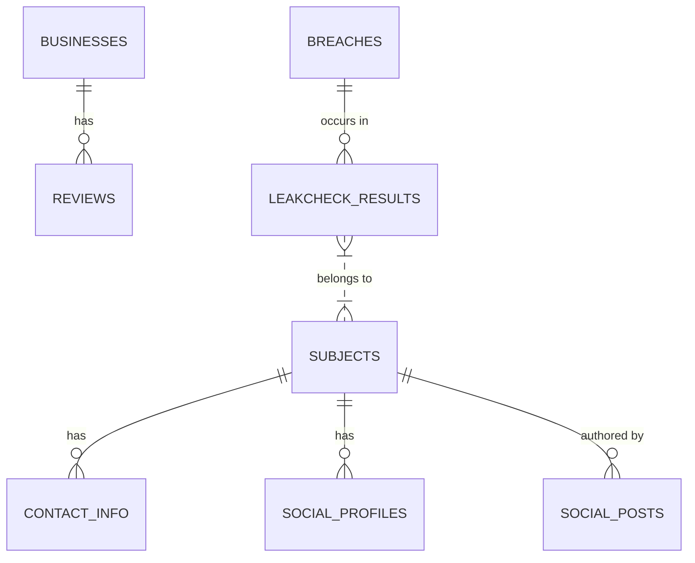
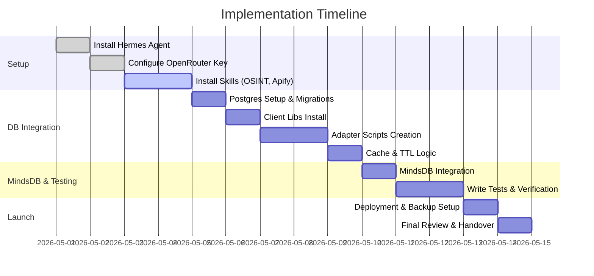

# Посібник зі встановлення та забезпечення збереження даних для Hermes Agent на Ubuntu 24.04

**Короткий виклад:** Цей посібник описує встановлення самовдосконалюваного агента Hermes, його налаштування з моделлю Qwen 3.6 через OpenRouter, а також додавання навичок на базі OSINT і Apify. Далі ми налаштовуємо локальну базу даних PostgreSQL (`hermes_db`) для збереження всіх результатів роботи навичок і реалізуємо логіку cache-first lookup з дедуплікацією (з використанням правил TTL). Hermes буде проінструктовано (через жорсткий промпт) виконати аудит кожної навички, створити міграції, встановити клієнтські бібліотеки та згенерувати окремі скрипти-адаптери для кожної навички в `~/.hermes/skills/<skill>/scripts`. Наприкінці ми розгортаємо MindsDB у Docker (контейнер `mindsdb`), підключаємо його до `hermes_db` через MCP і створюємо `breach_predictor` для даних leakcheck. Посібник містить точні команди, шляхи до файлів, фрагменти коду (Python/Node), приклади systemd/cron і тести.

## Промпт для Hermes Agent

Використайте таку одноразову інструкцію, щоб Hermes автономно виконав повну імплементацію:

```text
Implement a full PostgreSQL persistence and cache layer for my Hermes skills as follows:

- **Skills to audit:** ~/.hermes/skills/osint, ~/.hermes/skills/leakcheck, ~/.hermes/skills/apify-ultimate-scraper (and other Apify agent skills).
- **Postgres:** Create database `hermes_db`. Run migration SQL to create core tables (`query_log`, `raw_results`, `subjects`, `contacts`, `social_profiles`, `social_posts`, `businesses`, `reviews`, `breaches`, `leakcheck_results`, etc). 
- **Client libs:** Install psycopg2-binary, node-postgres (and requests/node-fetch) into Hermes’s repo venv.
- **Adapters:** Under each skill’s `scripts/` folder, add adapters (Python or Node) to parse that skill’s JSON/JSONL output and perform parameterized `INSERT ... ON CONFLICT` into Postgres.
- **Cache Lookup:** Modify skill wrappers so that before calling external APIs they run SQL queries against `hermes_db` (exact match first, then fuzzy/TTL checks). Skip the external call if cache hit, else call API and then upsert results.
- **Deduplication/TTL:** Use unique keys (e.g. email, platform+id, query parameters) and ON CONFLICT for idempotent upserts. Retain a `last_seen` timestamp and skip data older than a specified TTL (e.g. 30 days).
- **MindsDB:** The `mindsdb` Docker container is already running. Create a MindsDB integration with Postgres (via `CREATE DATABASE postgresql_conn ENGINE='postgres' ...`). Create a predictor `breach_predictor` on `leakcheck_results` (predicting the `found` field). Provide MindsDB SQL commands.
- **Systemd/Cron:** Add examples: a systemd service/timer or cron job for periodic syncs (e.g. fetching Apify results) and nightly `pg_dump` backups of `hermes_db`.
- **Env vars:** Update `~/.hermes/.env` with DB credentials (`DB_HOST`, `DB_PORT`, `DB_NAME`, `DB_USER`, `DB_PASS`), API keys, and model provider tokens. 
- **Testing:** Write unit tests for each adapter (in Python/Node) using sample JSON to assert DB inserts. Run an end-to-end test: e.g. a sample LeakCheck query and an Apify actor call, then verify the expected rows in Postgres and a MindsDB prediction query.
- **Implementation:** Do not just explain – inspect the local skill files and implement changes in-place. After each step, summarize changed/created files. Keep existing skill commands working. 

Begin by auditing the skill folders and then execute the steps above.
```

## Покрокова імплементація

### 1. Встановіть Hermes Agent і налаштуйте LLM

1. **Встановлення однорядковим скриптом:**  
   ```bash
   curl -fsSL https://raw.githubusercontent.com/NousResearch/hermes-agent/main/scripts/install.sh | bash
   source ~/.bashrc
   hermes doctor  # verify install
   ```
   Це клонує репозиторій, встановлює залежності (Python3.11, Node.js тощо) і налаштовує `~/.hermes/hermes-agent/venv`【36†L40-L47】.  

2. **Отримайте ключ OpenRouter:**  
   Зареєструйтеся на [openrouter.ai](https://openrouter.ai) і отримайте API-ключ.  

3. **Налаштуйте модель:** Відредагуйте `~/.hermes/.env`, додайте:  
   ```
   OPENROUTER_API_KEY=<your_key>
   ```
   Потім виконайте:
   ```bash
   hermes setup model
   ```
   У меню виберіть **OpenRouter** як провайдера і **Qwen-3.6** як модель. Це гарантує, що Hermes використовує модель Qwen 3.6 через OpenRouter.  

4. **Перевірте модель:**  
   Запустіть чат-сесію:
   ```bash
   hermes chat
   ```
   і поставте просте запитання, щоб переконатися, що Qwen відповідає. (Щоб змінити модель пізніше: `hermes model`.)

### 2. Встановіть і поясніть роботу OSINT Skill

1. **Клонування та встановлення:**  
   ```bash
   mkdir -p ~/.hermes/skills
   git clone https://github.com/smixs/osint-skill.git ~/.local/src/osint-skill
   cp -r ~/.local/src/osint-skill/osint ~/.hermes/skills/osint
   ```
   Це розміщує директорію навички `osint` (з файлами `SKILL.md` і скриптами) там, де Hermes зможе її використовувати.

2. **API, які використовує osint-skill:** Навичка OSINT використовує різні зовнішні API. Увімкніть кожне за потреби:  
   - **Apify Actors (`APIFY_API_TOKEN`):** Використовується для скрейпінгу (Instagram, TikTok, YouTube, LinkedIn тощо). Потрібен для скрейперів профілів і постів【40†L1-L4】.  
   - **Bright Data MCP (`BRIGHTDATA_MCP_URL`):** Використовується для обходу CAPTCHA та авторизації, скрейпінгу Facebook, пошуку в Yandex【41†L1-L2】.  
   - **Perplexity API (`PERPLEXITY_API_KEY`):** Sonar (швидкі AI-відповіді) і Deep Research【42†L1-L4】.  
   - **Exa AI (`EXA_API_KEY`):** Семантичний пошук людей і компаній【42†L1-L4】.  
   - **Jina AI (`JINA_API_KEY`):** Глибокий нейронний пошук у вебі та відкритих джерелах.  
   - **Parallel AI (`PARALLEL_API_KEY`):** AI-витягування даних і узагальнення результатів пошуку【40†L1-L4】.  
   - **Tavily (`TAVILY_API_KEY`):** Агентний пошук (для швидких Q&A)【43†L1-L4】.  
   - **LeakCheck (`LEAKCHECK_API_KEY`):** Пошук у базі витоків (профілі/витоки email).  
   - **Himalaya:** CLI-поштовий клієнт для внутрішнього пошуку пошти (без env var, але встановлюється через `sudo apt install himalaya`, потім `himalaya account configure`).  
   - **tg.py:** Telegram-скрипт для розвідки (якщо доступний). У навичці є посилання на `tg.py` для Telegram; якщо використовується, переконайтеся, що `tg.py` є в `PATH`.

3. **Увімкніть API:** У `~/.hermes/.env` додайте рядки на зразок:
   ```
   APIFY_API_TOKEN=apify_api_xxx
   JINA_API_KEY=jina_xxx
   PARALLEL_API_KEY=parallel_xxx
   TAVILY_API_KEY=tvly_xxx
   PERPLEXITY_API_KEY=pplx_xxx
   EXA_API_KEY=exa_xxx
   BRIGHTDATA_MCP_URL="https://mcp.brightdata.com/your_url"
   LEAKCHECK_API_KEY=your_leakcheck_key
   ```
   Вони відповідають наведеним вище API (див. джерела【40†L1-L4】【42†L1-L4】【43†L1-L4】).  

4. **Примітка:** Власний файл `SKILL.md` навички OSINT міститиме внутрішні кроки (Phases 0→6) і використовуватиме ці змінні середовища. Змін у коді тут не потрібно; достатньо переконатися, що в `.env` є ключі, аби, наприклад, `first-volley.sh` і `brightdata.sh` могли їх використовувати.

### 3. Додайте навички Apify Agent

1. **Встановіть репозиторій навичок:**  
   ```bash
   git clone https://github.com/apify/agent-skills.git ~/.local/src/apify-agent-skills
   ```
2. **Скопіюйте навички в Hermes:**  
   ```bash
   cp -r ~/.local/src/apify-agent-skills/skills/apify-ultimate-scraper ~/.hermes/skills/
   cp -r ~/.local/src/apify-agent-skills/skills/apify-actor-development ~/.hermes/skills/
   cp -r ~/.local/src/apify-agent-skills/skills/apify-actorization ~/.hermes/skills/
   cp -r ~/.local/src/apify-agent-skills/skills/apify-generate-output-schema ~/.hermes/skills/
   ```
   (Альтернативно можна використати `npx skills add apify/agent-skills`【49†L289-L297】, якщо доступний `npx`.) `apify-ultimate-scraper` — це основна навичка для скрейпінгу (підтримує 55+ платформ). Навички Apify вимагають Node.js 20+ і `APIFY_API_TOKEN`【49†L321-L327】; переконайтеся, що токен є у `.env`.

3. **API-токени:** Переконайтеся, що в `~/.hermes/.env` є `APIFY_TOKEN=<token>` для Apify (це псевдонім для APIFY_API_TOKEN). Зверніть увагу на точну назву ключа в `.env`, яку використовує навичка.  

### 4. Налаштуйте PostgreSQL і міграції

1. **Встановіть PostgreSQL:**  
   ```bash
   sudo apt update
   sudo apt install -y postgresql postgresql-contrib
   sudo systemctl enable --now postgresql
   ```
2. **Створіть БД і користувача:**  
   Перейдіть під користувача postgres:
   ```bash
   sudo -u postgres psql -c "CREATE DATABASE hermes_db;"
   sudo -u postgres psql -c "CREATE USER hermes_user WITH PASSWORD 'change_me';"
   sudo -u postgres psql -c "GRANT ALL PRIVILEGES ON DATABASE hermes_db TO hermes_user;"
   ```
3. **SQL міграції:** Створіть файл `hermes_db_migration.sql` з нормалізованою схемою. Приклад:

   ```sql
   -- hermes_db_migration.sql
   CREATE TABLE subjects (
       id SERIAL PRIMARY KEY,
       name TEXT UNIQUE,
       dob DATE,
       location TEXT
   );
   CREATE TABLE contact_info (
       id SERIAL PRIMARY KEY,
       subject_id INT REFERENCES subjects(id),
       type TEXT, value TEXT,
       first_seen TIMESTAMP DEFAULT NOW(),
       last_seen TIMESTAMP DEFAULT NOW(),
       UNIQUE(type, value)
   );
   CREATE TABLE social_profiles (
       id SERIAL PRIMARY KEY,
       subject_id INT REFERENCES subjects(id),
       platform TEXT, handle TEXT, url TEXT,
       followers INT, created_at TIMESTAMP DEFAULT NOW(),
       UNIQUE(platform, handle)
   );
   CREATE TABLE social_posts (
       id SERIAL PRIMARY KEY,
       author_id INT REFERENCES subjects(id),
       platform TEXT, post_id TEXT, content TEXT,
       created_at TIMESTAMP DEFAULT NOW(), url TEXT,
       UNIQUE(platform, post_id)
   );
   CREATE TABLE businesses (
       id SERIAL PRIMARY KEY,
       name TEXT, address TEXT,
       latitude DOUBLE PRECISION, longitude DOUBLE PRECISION,
       category TEXT, rating REAL
   );
   CREATE TABLE reviews (
       id SERIAL PRIMARY KEY,
       business_id INT REFERENCES businesses(id),
       reviewer_name TEXT, rating INT, content TEXT,
       created_at TIMESTAMP DEFAULT NOW()
   );
   CREATE TABLE breaches (
       id SERIAL PRIMARY KEY,
       source TEXT, breach_date DATE, unverified BOOLEAN, passwordless BOOLEAN,
       UNIQUE(source, breach_date)
   );
   CREATE TABLE leakcheck_results (
       id SERIAL PRIMARY KEY,
       subject_id INT REFERENCES subjects(id),
       breach_id INT REFERENCES breaches(id),
       email TEXT, first_name TEXT, last_name TEXT, username TEXT,
       found BOOLEAN,
       UNIQUE(email, breach_id)
   );
   -- Query log for reference (optional)
   CREATE TABLE query_log (
       id SERIAL PRIMARY KEY,
       skill TEXT, query TEXT, timestamp TIMESTAMP DEFAULT NOW()
   );
   ```
   Потім застосуйте файл:
   ```bash
   sudo -u postgres psql hermes_db -f hermes_db_migration.sql
   ```
   Це створить усі основні таблиці. (За потреби модифікуйте; неуточнені поля, наприклад політика retention, є опційними.)

### 5. Встановіть потрібні клієнтські бібліотеки

Активуйте Python venv Hermes і встановіть бібліотеки для роботи з БД:
```bash
source ~/.hermes/hermes-agent/venv/bin/activate
uv pip install psycopg2-binary
```
Для Node (оскільки адаптери навичок використовують node-postgres):
```bash
uv pip install -U pip  # ensure latest pip
npm install -g pg node-fetch
```
`uv` гарантує встановлення у venv репозиторію. Встановлення Node-пакетів може потребувати `npm install -g pg`, якщо середовище Hermes вже містить Node (так і має бути). Перевірте, що `which node` вказує на Node Hermes.

### 6. Створіть адаптери для кожної навички та змініть wrappers

Для кожної навички (osint, leakcheck, apify-ultimate-scraper) зробіть таке:

- **Спільний DB helper (опційно):** Створіть повторно використовуваний скрипт `~/.hermes/skills/_shared/db_helper.py`:
  ```python
  import os
  import psycopg2
  from psycopg2.extras import Json

  def get_conn():
      return psycopg2.connect(
          host=os.environ.get('DB_HOST','localhost'),
          port=os.environ.get('DB_PORT','5432'),
          dbname=os.environ.get('DB_NAME','hermes_db'),
          user=os.environ.get('DB_USER','hermes_user'),
          password=os.environ.get('DB_PASS','change_me')
      )

  def upsert_query(cur, table, columns, values, conflict_cols):
      cols = ','.join(columns)
      vals = ','.join(['%s']*len(values))
      conflict = ','.join(conflict_cols)
      update = ','.join([f"{col}=EXCLUDED.{col}" for col in columns if col not in conflict_cols])
      sql = f"INSERT INTO {table} ({cols}) VALUES ({vals}) ON CONFLICT ({conflict}) DO UPDATE SET {update}"
      cur.execute(sql, values)
  ```
  Цей helper (опційно) можна імпортувати в адаптери.

- **LeakCheck Adapter:** Створіть `~/.hermes/skills/leakcheck/scripts/insert.py`:
  ```python
  #!/usr/bin/env python3
  import os, sys, json
  from datetime import datetime
  from psycopg2 import sql
  from db_helper import get_conn

  if len(sys.argv) < 2:
      print("Usage: insert.py <result.json>")
      sys.exit(1)
  data = json.load(open(sys.argv[1]))
  conn = get_conn()
  cur = conn.cursor()
  email = data.get("email", "")
  breach_name = data["source"]["name"]
  breach_date = data["source"]["breach_date"]
  found = data.get("found", False)
  # Upsert breach
  cur.execute("INSERT INTO breaches (source, breach_date, unverified, passwordless) VALUES (%s,%s,%s,%s) ON CONFLICT (source, breach_date) DO NOTHING RETURNING id",
              (breach_name, breach_date, data["source"]["unverified"], data["source"]["passwordless"]))
  breach_id = cur.fetchone()[0] if cur.rowcount else None
  if not breach_id:
      cur.execute("SELECT id FROM breaches WHERE source=%s AND breach_date=%s", (breach_name, breach_date))
      breach_id = cur.fetchone()[0]
  # Upsert leakcheck_result
  cur.execute(
      "INSERT INTO leakcheck_results (email, first_name, last_name, username, breach_id, found) "
      "VALUES (%s,%s,%s,%s,%s,%s) "
      "ON CONFLICT (email, breach_id) DO UPDATE SET found = EXCLUDED.found;",
      (email, data.get("first_name"), data.get("last_name"), data.get("username"), breach_id, found)
  )
  conn.commit()
  cur.close()
  conn.close()
  ```
  Зробіть його виконуваним: `chmod +x insert.py`.

- **Зміна LeakCheck Wrapper:** Відредагуйте `~/.hermes/skills/leakcheck/SKILL.md` або entrypoint, щоб додати pre-check. Наприклад, у `query.sh` навички перед основною логікою додайте:
  ```bash
  RESULT_FILE="$HOME/.hermes/skills/leakcheck/results_${1}.json"
  # Check cache
  if psql -qt -U $DB_USER -d $DB_NAME -c "SELECT id FROM leakcheck_results WHERE email='$1' AND found=true AND last_seen >= NOW() - INTERVAL '30 days'" | grep -q '[0-9]'; then
      echo "Using cached LeakCheck data for $1"
      exit 0
  fi
  # Otherwise proceed with external call (the existing code), then save output to JSON:
  ./query.sh "$@" | tee $RESULT_FILE
  python3 $HERMES_SKILL_DIR/scripts/insert.py $RESULT_FILE
  ```

- **OSINT Adapter:** У навички багато виходів (наприклад, результати пошуку, збережені файли). Визначте, куди зберігаються результати (наприклад, `output/first-volley.json`). Для кожної фази додайте подібні скрипти-адаптери. Приклад (псевдокод):
  ```python
  # insert_search.py
  import json, psycopg2
  from db_helper import get_conn
  data = json.load(open('output/first-volley.json'))
  conn = get_conn(); cur = conn.cursor()
  for item in data["results"]:
      cur.execute(
          "INSERT INTO social_posts (author_id, platform, post_id, content, url) "
          "VALUES (%s,%s,%s,%s,%s) ON CONFLICT (platform, post_id) DO NOTHING",
          (None, item["platform"], item["id"], item["snippet"], item["url"])
      )
  conn.commit(); conn.close()
  ```
  Вставте `None` або попередньо знайдіть `subject_id`, якщо потрібно. Потім змініть скрипти навички osint так, щоб після кожного етапу вони викликали ці вставки.

- **Apify Adapter:** Після запуску актора Apify (через `node run_actor.js ... --output output.json`) додайте крок:
  ```bash
  node --env-file=.env ${HERMES_SKILL_DIR}/scripts/run_actor.js --actor "actorId" --input '{}' --output output.json
  python3 ~/.hermes/skills/_shared/apify_insert.py output.json
  ```
  І створіть `apify_insert.py`, щоб читати JSON і виконувати upsert у таблиці за аналогією. Наприклад:
  ```python
  import json, psycopg2
  conn = psycopg2.connect(...) 
  cur = conn.cursor()
  data = json.load(open('output.json'))
  for record in data:
      cur.execute("INSERT INTO social_posts (platform, post_id, content) VALUES (%s,%s,%s) ON CONFLICT (platform, post_id) DO NOTHING",
                  (record.get("platform"), record.get("id"), record.get("text")))
  conn.commit()
  ```

Кожен адаптер має використовувати параметризовані запити (`%s`) і `ON CONFLICT`. Розміщуйте скрипти-адаптери в `~/.hermes/skills/<skill>/scripts/`. Переконайтеся, що wrappers навичок (наприклад виклики `run_actor.sh`) змінено так, щоб вони викликали ці скрипти після успішного отримання результатів.

### 7. Додайте логіку кешу та TTL

Змініть entrypoint кожної навички так, щоб перед зверненням до зовнішніх API вона перевіряла БД:

- **Точний збіг:** Наприклад, у скрейпері Apify: перед запуском актора для конкретної сутності або запиту виконайте `SELECT` по відповідній таблиці (наприклад, `social_profiles`), щоб перевірити, чи цей profile ID уже скрейпився нещодавно.
- **TTL:** Додайте в таблиці позначку часу `last_seen` (або використовуйте `created_at`) і умови на кшталт `AND created_at > NOW() - INTERVAL '30 days'`. Якщо дані існують і вони свіжі, зовнішній виклик можна пропустити.

Наприклад, у Bash wrapper:
```bash
ID="some_input"
if psql -qt -U $DB_USER -d $DB_NAME -c "SELECT id FROM social_profiles WHERE handle='$ID' AND created_at >= NOW()-'30 days'::interval" | grep -q '[0-9]'; then
    echo "Found recent data for $ID, skipping external call"
    exit 0
fi
# Else run scraper and then adapter
```
Використовуйте `sqlite3` або `psql` за потреби.

### 8. Інтегруйте MindsDB (Docker “mindsdb”)

1. **Створіть інтеграцію з Postgres:** У консолі MindsDB (або через CLI) підключіться до Postgres. Наприклад, виконайте в MindsDB:
   ```sql
   CREATE DATABASE hermes_conn
   WITH ENGINE = 'postgres'
   PARAMETERS = {
       "host": "host.docker.internal",
       "port": "5432",
       "database": "hermes_db",
       "user": "hermes_user",
       "password": "change_me"
   };
   ```
   (Використовуйте `host.docker.internal`, якщо підключення йде з Docker до хоста, або назву сервісу, якщо використовується Docker network.)  

2. **Перевірте з’єднання:**  
   ```sql
   SELECT * FROM hermes_conn.social_profiles LIMIT 5;
   ```

3. **Створіть `breach_predictor`:** Навчіть модель на `leakcheck_results`, щоб прогнозувати, чи має email витоки:
   ```sql
   CREATE PREDICTOR breach_predictor
   FROM hermes_conn (
       SELECT email, found FROM leakcheck_results
   ) AS t
   PREDICT found;
   ```
   (Це вказує MindsDB тренувати модель на `leakcheck_results.found`, використовуючи `email` як ознаку【51†L165-L173】.)

4. **Перевірте прогноз:**  
   ```sql
   SELECT found_explain FROM mindsdb.breach_predictor
   WHERE email = 'example@example.com';
   ```
   Це поверне прогноз моделі та рівень упевненості.  

### 9. Налаштуйте Systemd і Cron

- **Cron (резервні копії):** Додайте щоденний бекап у crontab (від користувача `postgres`):
  ```cron
  0 2 * * * /usr/bin/pg_dump hermes_db > /backups/hermes_db_$(date +\%F).sql
  ```
  Це створюватиме дамп `hermes_db` щодня о 02:00.  

- **Cron (синхронізація):** За потреби налаштуйте періодичну синхронізацію даних. Наприклад, запускати скрипт-адаптер щогодини:
  ```cron
  0 * * * * /home/ubuntu/.hermes/skills/osint/scripts/insert_search.sh
  ```
  (Підкоригуйте шлях і назву скрипта відповідно до вашої системи.)  

- **Приклад Systemd:** Можна також створити сервіс (і, за бажанням, таймер). Наприклад, `/etc/systemd/system/hermes-sync.service`:
  ```ini
  [Unit]
  Description=Hermes Data Sync
  After=network.target

  [Service]
  Type=oneshot
  ExecStart=/home/ubuntu/sync_hermes_data.sh
  ```
  І `/etc/systemd/system/hermes-sync.timer`:
  ```ini
  [Unit]
  Description=Run Hermes Data Sync hourly

  [Timer]
  OnCalendar=hourly

  [Install]
  WantedBy=timers.target
  ```
  Де `sync_hermes_data.sh` містить команди для отримання нових даних або запуску скриптів. Увімкнення:
  ```bash
  sudo systemctl enable --now hermes-sync.timer
  ```

### 10. Налаштуйте `.env` та інструменти для apify-skill

- **Файл змінних середовища:** Переконайтеся, що `~/.hermes/.env` містить усі потрібні ключі:
  ```
  OPENROUTER_API_KEY=...
  APIFY_TOKEN=...
  APIFY_API_TOKEN=...   # sometimes agent-skills use APIFY_TOKEN
  JINA_API_KEY=...
  PARALLEL_API_KEY=...
  TAVILY_API_KEY=...
  PERPLEXITY_API_KEY=...
  EXA_API_KEY=...
  BRIGHTDATA_MCP_URL=...
  LEAKCHECK_API_KEY=...
  HIMALAYA_API_KEY=...  # if any (Himalaya uses OAuth - may skip)
  ```
- **CLI-інструменти:** Для навичок Apify agent skills встановіть Apify CLI (опційно):
  ```bash
  npm install -g apify-cli
  # or for agents:
  npm install -g @apify/mcpc
  ```
  (Офіційна навичка Apify також використовує `mcpc` для пошуку акторів【47†L99-L107】.)

### 11. Тестування

- **Unit-тести:** У кожній директорії `scripts/` навички створіть тестовий файл (наприклад, `test_insert.py`), який завантажує приклад JSON-виходу і перевіряє вставку в БД (використовуючи тимчасову тестову БД або тестову таблицю). Наприклад, через `pytest`:
  ```python
  def test_leakcheck_insert(tmp_path, monkeypatch):
      # Prepare sample JSON file
      sample = {'email':'a@b.com','source':{'name':'BreachedDB','breach_date':'2023-01-01','unverified':False,'passwordless':False},'first_name':'A','last_name':'B','username':'ab','found':True}
      f = tmp_path / "res.json"; f.write_text(json.dumps(sample))
      monkeypatch.setenv('DB_NAME','hermes_db_test')
      # Run insert
      os.system(f"python3 insert.py {f}")
      # Check DB for record (needs DB setup for tests)
      conn = psycopg2.connect(...)
      cur = conn.cursor()
      cur.execute("SELECT email, first_name FROM leakcheck_results WHERE email='a@b.com'")
      row = cur.fetchone()
      assert row == ('a@b.com','A')
  ```
- **Наскрізний тест (end-to-end):** 
  1. Запустіть перевірку LeakCheck через Hermes CLI або навичку, наприклад:
     ```bash
     hermes run leakcheck example@example.com
     ```
     Переконайтеся, що в Postgres у `leakcheck_results` є рядок для `example@example.com`.
  2. Запустіть навичку з Apify actor, наприклад:
     ```bash
     hermes run apify-ultimate-scraper '{"url":"https://example.com"}'
     ```
     (Або використайте відомий невеликий actor для тесту.) Переконайтеся, що відповідні дані з’явилися, наприклад, у `social_posts` або `businesses`.
  3. Виконайте запит у MindsDB:
     ```bash
     # In MindsDB SQL:
     SELECT found FROM mindsdb.breach_predictor WHERE email='example@example.com';
     ```
     Має повернутися прогноз.  

За потреби відкоригуйте тести й команди відповідно до ваших фактичних даних та схеми.

### 12. Розгорніть Hugging Face OSINT Model

Модель HF `aab20abdullah/qwen_OSINT` (4B Qwen3) недоступна як публічне inference API. Є два варіанти:

- **Запустити локально (Ollama або llama.cpp):**  
  1. Встановіть Ollama (або використайте llama.cpp):
     ```bash
     curl -fsSL https://ollama.ai/install.sh | bash
     ollama pull aab20abdullah/qwen_OSINT
     ```
  2. Налаштуйте Hermes на використання цієї моделі як кастомного LLM endpoint. У `~/.hermes/.env` додайте:
     ```
     HERMES_MODEL=qwen_OSINT
     ```
     Потім виконайте:
     ```bash
     hermes setup model
     ```
     Виберіть **Ollama** як провайдера і `aab20abdullah/qwen_OSINT` як модель.
     Альтернативно, якщо використовуєте `hermes profile`, виконайте:
     ```
     hermes profile create osint-agent
     hermes profile use osint-agent
     hermes model   # select Ollama -> qwen_OSINT
     ```

- **Розгорнути на хмарному inference provider:**  
  Створіть inference endpoint (Hugging Face або інший провайдер) для цієї моделі:
  1. На Hugging Face перейдіть у **Endpoints → Create Endpoint**, виберіть `aab20abdullah/qwen_OSINT`.
  2. Дочекайтеся завершення розгортання, потім отримайте API URL і токен.
  3. У `~/.hermes/.env` встановіть:
     ```
     HF_TOKEN=<your_hf_token>
     HERMES_MODEL=qwen_OSINT
     ```
     Виконайте `hermes setup model` і виберіть **Hugging Face** з моделлю `qwen_OSINT`.

Якщо інше не вказано, можна розгорнути на будь-якому провайдері (наприклад Hugging Face Inference або Replicate). Картка моделі також радить використовувати `llama-cli` для локального запуску【54†L51-L55】.  

### Mermaid ER Diagram і Timeline

Нижче наведено спрощену ER-діаграму основної схеми Postgres:



Gantt-діаграма впровадження:



